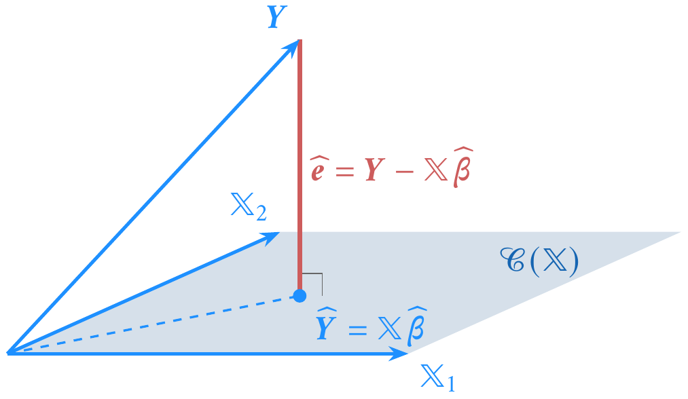

# The mechanics of least squares {#sec-ols-mechanics}


```{r}
#| message: false
#| warning: false
#| echo: false
library(tidyverse)
```

This chapter explores the most widely used estimator for population linear regressions: **ordinary least squares** (OLS). OLS is a plug-in estimator for the best linear projection (or population linear regression) described in the last chapter. Its popularity is partly due to its ease of interpretation and computational simplicity. Because most people in the quantitative social sciences rely extensively on OLS for their own research, the time you spend developing deep familiarity with this approach will serve you well. In this chapter, we focus on motivating the estimator and the mechanical or algebraic properties of the OLS estimator. In the next chapter, we will investigate its statistical properties.  

@fig-ajr-scatter shows the relationship between log GDP per capita in 1995 and a measure of the strength of property rights (called average protection against expropriation risk) for the 111 countries in the data of @AceJohRob01. The red line represents the ordinary least squares line of best fit. In this chapter, we will see how to derive this line and how to tell how well this line fits the data. We will also see how to write the OLS estimator compactly with matrices, and how individual influential countries can affect the estimate. 

```{r}
#| label: fig-ajr-scatter
#| echo: false
#| fig-alt: >
#|  Scatterplot of log GDP per capita in 1995 (vertical axis, about 6 to
#|  10.3) against average protection against expropriation risk (horizontal
#|  axis, about 3.5 to 10) for 111 countries. The points rise from lower
#|  left to upper right, and a red OLS line with a positive slope of about
#|  0.53 runs through them.
#| fig-cap: |
#|   Relationship between political institutions and economic
#|   development from @AceJohRob01 for the $n = 111$ countries from 
#|   their data with data on both variables. 
ajr <- foreign::read.dta("assets/data/ajr.dta")

mod <- lm(logpgp95 ~ avexpr, data = ajr)

plot(logpgp95 ~ avexpr,
  data = ajr, pch = 19, col = "grey80",
  bty = "n", las = 1,
  xlab = "Average Protection against Expropriation Risk",
  ylab = "Log GDP per capita, 1995"
)
title("Political Institutions and Economic Development", adj = 0, line = 0)
abline(mod, lwd = 3, col = "indianred")
```


## Deriving the OLS estimator 

The last chapter on the linear projection operated purely in the population, not samples. We derived the population regression coefficients $\bfbeta$, representing the coefficients on the line of best fit in the population. We now take these as our quantities of interest and focus on how to use a sample from the population to make inferences about the line of best fit in the population. To do this, we will focus on the OLS estimator for these population quantities. 

We first make a key assumption to ensure the OLS estimator exists and has a unique solution. 

::: {#cnj-ols-pd}

## Positive definiteness

The matrix $\sum_{i=1}^n \X_i\X_i'$ is positive definite. 

:::

Intuitively, the assumption is the sample version of the third part of @cnj-blp-assumptions from @sec-regression (see there for a definition and discussion of positive definiteness). In this context, it requires we have more observations than parameters ($n > k+1$) and that there is no multicollinearity (no entries of $\X_i$ are deterministic linear combinations of the other entries). Below in @sec-rank, we discuss equivalent conditions for this assumption in terms of data matrices. 

Recall the population linear projection coefficients (or best linear predictor coefficients) that we derived in @thm-blp,
$$ 
\bfbeta = \argmin_{\mb{b} \in \real^{k+1}}\; \E\bigl[ \bigl(Y_{i} - \mb{X}_{i}'\mb{b} \bigr)^2\bigr] = \left(\E[\X_{i}\X_{i}']\right)^{-1}\E[\X_{i}Y_{i}].
$$

We will consider two different ways to derive the OLS estimator for these coefficients, both of which are versions of the plug-in principle. The first approach is to use the closed-form representation of the coefficients and replace any expectations with sample means,
$$ 
\bhat = \left(\frac{1}{n} \sum_{i=1}^n \X_i\X_i' \right)^{-1} \left(\frac{1}{n} \sum_{i=1}^n \X_{i}Y_{i} \right).
$$
This will exist and be unique so long as @cnj-ols-pd holds.


In a simple bivariate linear projection model $m(X_{i}) = \beta_0 + \beta_1X_{i}$, we saw that the population slope was $\beta_1= \cov(Y_{i},X_{i})/ \V[X_{i}]$. This approach means that the estimator for the slope should be the ratio of the sample covariance of $Y_i$ and $X_i$ to the sample variance of $X_i$, or
$$ 
\widehat{\beta}_{1} = \frac{\widehat{\sigma}_{Y,X}}{\widehat{\sigma}^{2}_{X}} = \frac{ \frac{1}{n}\sum_{i=1}^{n} (Y_{i} - \overline{Y})(X_{i} - \overline{X})}{\frac{1}{n} \sum_{i=1}^{n} (X_{i} - \Xbar)^{2}}.
$$

This plug-in approach is widely applicable and tends to have excellent properties in large samples under iid data. But the simplicity of the plug-in approach also hides some features of the estimator that become more apparent when deriving the estimator more explicitly using calculus. 

The second approach applies the plug-in principle not to the closed-form expression for the coefficients but to the optimization problem itself. We call this the **least squares** estimator because it minimizes the empirical (or sample) squared prediction error,
$$ 
\bhat = \argmin_{\mb{b} \in \real^{k+1}}\; \frac{1}{n} \sum_{i=1}^{n}\bigl(Y_{i} - \mb{X}_{i}'\mb{b} \bigr)^2 = \argmin_{\mb{b} \in \real^{k+1}}\; SSR(\mb{b}),
$$ {#eq-ols-objective}
where,
$$ 
SSR(\mb{b}) = \sum_{i=1}^{n}\bigl(Y_{i} - \mb{X}_{i}'\mb{b} \bigr)^2
$$
is the sum of the squared residuals. To distinguish it from other, more complicated least squares estimators, we call this the **ordinary least squares** estimator, or OLS. 

Let's solve this minimization problem. We can use the chain rule to differentiate $(Y_i - \X_i'\mb{b})^2$ with respect to $\mb{b}$ in a similar way as the scalar case, giving $-2\X_i(Y_i - \X_i'\mb{b})$.  Thus, the first-order conditions will be 
$$ 
0= \left.\frac{\partial SSR(\mb{b})}{\partial \mb{b}}\right|_{\mb{b}=\bhat} = -2 \left(\sum_{i=1}^{n} \X_{i}Y_{i}\right) + 2\left(\sum_{i=1}^{n}\X_{i}\X_{i}'\right)\bhat.
$$
We can rearrange this system of equations to
$$ 
\left(\sum_{i=1}^{n}\X_{i}\X_{i}'\right)\bhat = \left(\sum_{i=1}^{n} \X_{i}Y_{i}\right).
$$ {#eq-normal-equations}

To obtain the solution for $\bhat$, notice that $\sum_{i=1}^{n}\X_{i}\X_{i}'$ is a $(k+1) \times (k+1)$ matrix and $\bhat$ and $\sum_{i=1}^{n} \X_{i}Y_{i}$ are both $k+1$ length column vectors. If $\sum_{i=1}^{n}\X_{i}\X_{i}'$ is invertible, then we can multiply both sides of this equation by that inverse to arrive at
$$ 
\bhat = \left(\sum_{i=1}^n \X_i\X_i' \right)^{-1} \left(\sum_{i=1}^n \X_{i}Y_{i} \right),
$$
which is the same expression as the plug-in estimator (after canceling the $1/n$ terms). To confirm that we have found a unique minimum, we also need to check the second-order condition that 
$$ 
 \frac{\partial^{2} SSR(\mb{b})}{\partial \mb{b}\mb{b}'} = 2\left(\sum_{i=1}^{n}\X_{i}\X_{i}'\right)
$$
is positive definite, which is ensured by @cnj-ols-pd. 

Both the plug-in and least squares approaches yield the same estimator for the best linear predictor/population linear regression coefficients, which is the in-sample version of the population linear projection derived in @thm-blp. 

::: {#thm-ols}

Under @cnj-ols-pd, the unique minimizer to @eq-ols-objective is the ordinary least squares estimator
$$
\bhat = \left(\sum_{i=1}^n \X_i\X_i' \right)^{-1} \left(\sum_{i=1}^n \X_{i}Y_{i} \right).
$$

:::


::: {.callout-note}

## Formula for the OLS slopes

Almost all regressions will contain an intercept term, usually represented as a constant 1 in the covariate vector. It is also possible to obtain expressions for the OLS estimates of the intercept and variable coefficients separately. We can rewrite the best linear predictor decomposition as 
$$ 
Y_{i} = \beta_{0} + \X_{i,-0}'\bfbeta_{-0} + e_{i},
$$
where $\X_{i,-0}$ is the covariate vector without the constant and $\bfbeta_{-0}$ is the coefficient vector without the intercept. Defined this way, we can write the OLS estimator for the "slopes" on $\X_{i,-0}$ as the OLS estimator with all variables demeaned:
$$ 
\bhat_[-0] = \left(\frac{1}{n} \sum_{i=1}^{n} (\X_{i,-0} - \overline{\X}_{-0})(\X_{i,-0} - \overline{\X}_{-0})'\right)^{-1} \left(\frac{1}{n} \sum_{i=1}^{n}(\X_{i,-0} - \overline{\X}_{-0})(Y_{i} - \overline{Y})\right)
$$
which is the inverse of the sample covariance matrix of $\X_{i,-0}$ times the sample covariance of $\X_{i,-0}$ and $Y_i$. The intercept is 
$$ 
\widehat{\beta}_0 = \overline{Y} - \overline{\X}_{-0}'\bhat_{-0}.
$$

:::

When dealing with actual data and not the population, we refer to the prediction errors $\widehat{e}_{i} = Y_i - \X_i'\bhat$ as the **residuals**. The predicted value itself, $\widehat{Y}_i = \X_{i}'\bhat$, is also called the **fitted value**. With the population linear regression, we saw that the projection errors, $e_i = Y_i - \X_i'\bfbeta$, were mean zero and uncorrelated with the covariates, $\E[\X_{i}e_{i}] = 0$. The residuals have a similar property with respect to the covariates in the sample. Rearranging @eq-normal-equations, we have
$$
\begin{aligned}
0 &= \sum_{i=1}^n (\X_iY_i -  \X_i\X_i'\bhat) \\
&= \sum_{i=1}^n \X_i(Y_i -  \X_i'\bhat) \\
&= \sum_{i=1}^n \X_i\widehat{e}_i.
\end{aligned}
$$
Furthermore, if $\X_i$ includes a constant, then this also implies that $\sum_{i=1}^n \widehat{e}_i = 0$ as well. The residuals are *exactly* uncorrelated with the covariates (when the covariates include a constant/intercept term), which is a mechanical artifact of the OLS estimator.  


@fig-ssr-comp shows how OLS works in the bivariate case. It displays three possible regression lines as well as the sum of the squared residuals for each line (with the intercept chosen optimally for each slope). OLS aims to find the line that minimizes the function on the right.  

```{r}
#| label: fig-ssr-comp
#| echo: false
#| fig-alt: >
#|  Two panels. The left panel shows the AJR scatterplot of log GDP per
#|  capita against protection against expropriation risk with three lines
#|  through the point of means: one with a negative slope (dashed), the OLS
#|  line (solid), and one that is too steep (dotted). The right panel plots
#|  the sum of squared residuals as a U-shaped curve in the slope b1 from -1
#|  to 2, with colored vertical segments marking the three slopes; the OLS
#|  slope sits at the bottom of the curve.
#| fig-cap: | 
#|   Different possible lines and their corresponding sum of squared residuals. 
library(RColorBrewer)
ey2 <- var(mod$model$logpgp95)
exy <- cov(mod$model$logpgp95, mod$model$avexpr)
ex2 <- var(mod$model$avexpr)
ex <- mean(mod$model$avexpr)
ey <- mean(mod$model$logpgp95)
n <- length(mod$model$avexpr)
ssr <- function(x) (n - 1) * (ey2 - 2 * x * exy + x^2 * ex2)
par(mfrow = c(1, 2))
plot(ajr$avexpr, ajr$logpgp95,
  xlab = "Average Protection against\nExpropriation Risk",
  ylab = "Log GDP per capita, 1995", pch = 19, bty = "n",
  col = adjustcolor("grey60", alpha = 0.25), las = 1
)
slopes <- c(-0.5, coef(mod)[2], 1.5)
cols <- brewer.pal(n = 3, "Dark2")
ltys <- c(2, 1, 3)
for (i in seq_along(slopes)) {
  b1 <- slopes[i]
  b0 <- ey - b1 * ex
  abline(a = b0, b = b1, col = cols[i], lwd = 5, lty = ltys[i])
}

curve(ssr,
  from = -1, to = 2, ylim = c(-0.5, ssr(-1) * 1.1),
  bty = "n", lwd = 2, xlab = expression(b[1]),
  ylab = ""
)
mtext(side = 2, line = 2, expression(SSR(b[1])), las = 1)
title("Sum of Squared Residuals")
for (i in seq_along(slopes)) {
  b1 <- slopes[i]
  b0 <- ey - b1 * ex
  segments(
    x0 = b1, y0 = -10, y1 = ssr(b1),
    lwd = 4, col = cols[i], lty = ltys[i]
  )
}
```

## Model fit

We have learned how to use OLS to obtain an estimate of the best linear predictor, but an open question is whether that prediction is any good. Does using $\X_i$ help us predict $Y_i$? To investigate this, we consider two different prediction errors: (1) those using covariates and (2) those that do not. 

We have already seen the prediction error when using the covariates; it is just the **sum of the squared residuals**,
$$ 
SSR = \sum_{i=1}^n (Y_i - \X_{i}'\bhat)^2.
$$
Recall that the best predictor for $Y_i$ without any covariates is simply its sample mean $\overline{Y}$. The prediction error without covariates is what we call the **total sum of squares**,
$$ 
TSS = \sum_{i=1}^n (Y_i - \overline{Y})^2.
$$
@fig-ssr-vs-tss shows the difference between these two types of prediction errors. 


```{r}
#| label: fig-ssr-vs-tss
#| echo: false
#| fig-alt: >
#|  Two panels of the same AJR scatterplot. The left panel, "Total
#|  Prediction Errors," draws a horizontal blue line at the mean of log GDP
#|  per capita with vertical blue segments from each point to that line. The
#|  right panel, "Residuals," draws the red OLS line with vertical red
#|  segments from each point to the line; these segments are visibly shorter
#|  than the ones in the left panel.
#| fig-cap: Total sum of squares vs. the sum of squared residuals.
par(mfrow = c(1, 2), mar = c(4, 4, 2, 0.1))
ajr.mod <- lm(logpgp95 ~ avexpr, data = ajr)
ajr.dat <- model.frame(ajr.mod, data = ajr)
plot(ajr$avexpr, ajr$logpgp95, xlab = "Average Protection against\n Expropriation Risk", ylab = "Log GDP per capita, 1995", pch = 19, bty = "n", xlim = c(3, 10), ylim = c(6, 12), col = "grey60", main = "Total Prediction Errors")
abline(h = mean(ajr.dat$logpgp95, na.rm = TRUE), col = "dodgerblue", lwd = 3)
segments(x0 = ajr.dat$avexpr, y0 = ajr.dat$logpgp95, y1 = mean(ajr.dat$logpgp95), col = "dodgerblue")
text(x = 3, y = mean(ajr.dat$logpgp95), expression(bar(Y)), col = "dodgerblue", pos = 3, cex = 1.2)
plot(ajr$avexpr, ajr$logpgp95, xlab = "Average Protection against\n Expropriation Risk", ylab = "Log GDP per capita, 1995", pch = 19, bty = "n", xlim = c(3, 10), ylim = c(6, 12), col = "grey60", main = "Residuals")
abline(ajr.mod, col = "indianred", lwd = 3)
segments(x0 = ajr.dat$avexpr, y0 = ajr.dat$logpgp95, y1 = ajr.mod$fitted, col = "indianred")
text(x = 3, y = 6.25, expression(widehat(Y)[i]), col = "indianred", pos = 3, cex = 1.2)
```

We can use the **proportional reduction in prediction error** from adding those covariates to measure how much those covariates improve the regression's predictive ability. This value, called the **coefficient of determination** or $R^2$, is simply
$$
R^2 = \frac{TSS - SSR}{TSS} = 1-\frac{SSR}{TSS}.
$$
The numerator, $TSS - SSR$, is the reduction in prediction error moving from $\overline{Y}$ to $\X_i'\bhat$ as the predictor. The denominator is the prediction error using $\overline{Y}$.  Thus, the $R^2$ value is the fraction of the total prediction error eliminated by using $\X_i$ to predict $Y_i$. Another way to think about this value is that it measures how much less noisy the residuals are relative to the overall variation in $Y$. 

One thing to note is that, as long as $\X_i$ includes a constant, OLS will never worsen in-sample fit so that $TSS \geq SSR$ even if $\X_i$ is unrelated to $Y_i$. This phantom improvement occurs because the point of OLS is to minimize the SSR, and it will do that even if it is just chasing noise. Thus, $R^2$ will fall between 0 and 1 in this case. A value of zero would indicate exactly 0 estimated coefficients on all covariates (except the intercept) so that $Y_i$ is exactly uncorrelated with each independent variable in the sample. (This is very unlikely to occur because there will likely be some minimal but nonzero relationship by random chance.) A value of 1 indicates a perfect linear fit, which occurs when all data points are perfectly predicted by the model with zero residuals. In @fig-ajr-scatter, the $R^2$ is `r round(summary(mod)$r.squared, 2)`. 

## Matrix form of OLS

We derived the OLS estimator above using simple algebra and calculus, but a more common representation of the estimator relies on vectors and matrices. We usually write the linear projection for a generic unit, $Y_i = \X_i'\bfbeta + e_i$, but obviously, there are $n$ of these equations,
$$ 
\begin{aligned}
  Y_1 &= \X_1'\bfbeta + e_1 \\
  Y_2 &= \X_2'\bfbeta + e_2 \\
  &\vdots \\
  Y_n &= \X_n'\bfbeta + e_n \\
\end{aligned}
$$
We can write this system of equations more compactly using matrix algebra. Combining the variables here into random vectors/matrices gives us:
$$
\mb{Y} = \begin{pmatrix}
Y_1 \\ Y_2 \\ \vdots \\ Y_n
  \end{pmatrix}, \quad
  \mathbb{X} = \begin{pmatrix}
\X'_1 \\
\X'_2 \\
\vdots \\
\X'_n
  \end{pmatrix} =
  \begin{pmatrix}
    1 & X_{11} & X_{12} & \cdots & X_{1k} \\
    1 & X_{21} & X_{22} & \cdots & X_{2k} \\
    \vdots & \vdots & \vdots & \vdots & \vdots \\
    1 & X_{n1} & X_{n2} & \cdots & X_{nk} \\
  \end{pmatrix},
  \quad
  \mb{e} = \begin{pmatrix}
e_1 \\ e_2 \\ \vdots \\ e_n
  \end{pmatrix}
$$
We can write the above system of equations as
$$
\mb{Y} = \mathbb{X}\bfbeta + \mb{e}. 
$$
Note that $\mathbb{X}$ is an $n \times (k+1)$ matrix and $\bfbeta$ is a $k+1$ length column vector. 

Representing sums in matrix form is the critical link between the definition of OLS and matrix notation. In particular, we have
$$
\begin{aligned}
  \sum_{i=1}^n \X_i\X_i' &= \Xmat'\Xmat \\
  \sum_{i=1}^n \X_iY_i &= \Xmat'\mb{Y}.
\end{aligned}
$$
To see how the first of these holds, note that the $(j, \ell)$ entry of $\Xmat'\Xmat$ is the inner product of columns $j$ and $\ell$, which is exactly the $(j, \ell)$ entry of $\sum_{i=1}^n \X_i\X_i'$. These results means we can write the OLS estimator in the more recognizable form 
$$ 
\bhat = \left( \mathbb{X}'\mathbb{X} \right)^{-1} \mathbb{X}'\mb{Y}.
$$

We can of course also define the vector of residuals,
$$ 
 \widehat{\mb{e}} = \mb{Y} - \mathbb{X}\bhat = \left[
\begin{array}{c}
    Y_1 \\
    Y_2 \\
    \vdots \\
    Y_n
    \end{array}
\right] - 
\left[
\begin{array}{c}
   1\widehat{\beta}_0 + X_{11}\widehat{\beta}_1 + X_{12}\widehat{\beta}_2 + \dots + X_{1k}\widehat{\beta}_k \\
   1\widehat{\beta}_0 + X_{21}\widehat{\beta}_1 + X_{22}\widehat{\beta}_2 + \dots + X_{2k}\widehat{\beta}_k \\
   \vdots \\
   1\widehat{\beta}_0 + X_{n1}\widehat{\beta}_1 + X_{n2}\widehat{\beta}_2 + \dots + X_{nk}\widehat{\beta}_k
\end{array}
\right],
$$
and so the sum of the squared residuals in this case becomes
$$ 
SSR(\mb{b}) = \Vert\mb{Y} - \mathbb{X}\mb{b}\Vert^{2} = (\mb{Y} - \mathbb{X}\mb{b})'(\mb{Y} - \mathbb{X}\mb{b}),
$$
where the double vertical lines are the Euclidean norm of the argument, $\Vert \mb{z} \Vert = \sqrt{\sum_{i=1}^n z_i^{2}}$. The OLS minimization problem, then, is 
$$ 
\bhat = \argmin_{\mb{b} \in \real^{(k+1)}}\; \Vert\mb{Y} - \mathbb{X}\mb{b}\Vert^{2}
$$
Finally, the first-order conditions allow us to write
$$ 
\mathbb{X}'\widehat{\mb{e}} = \sum_{i=1}^{n} \X_{i}\widehat{e}_{i} = 0,
$$
which means the residual vector is **orthogonal** to every column of $\Xmat$. If $\Xmat$ includes a constant, this also implies the residuals are uncorrelated with each covariate. 

### Rank, linear independence, and multicollinearity {#sec-rank}

We noted that the OLS estimator exists and is unique when $\sum_{i=1}^n \X_i\X_i'$ is positive definite or that there is "no multicollinearity." This assumption is equivalent to saying that the matrix $\mathbb{X}$ is full column rank, meaning that $\text{rank}(\mathbb{X}) = (k+1)$, where $k+1$ is the number of columns of $\mathbb{X}$. Recall from matrix algebra that the column rank is the number of linearly independent columns in the matrix, and **linear independence** means that $\mathbb{X}\mb{b} = 0$ if and only if $\mb{b}$ is a column vector of 0s. In other words, we have
$$ 
b_{1}\mathbb{X}_{1} + b_{2}\mathbb{X}_{2} + \cdots + b_{k+1}\mathbb{X}_{k+1} = 0 \quad\iff\quad b_{1} = b_{2} = \cdots = b_{k+1} = 0, 
$$
where $\mathbb{X}_j$ is the $j$th column of $\mathbb{X}$. Thus, full column rank says that all the columns are linearly independent or that there is no "multicollinearity."

Could this be violated? Suppose we accidentally included a linear function of another variable so that $\mathbb{X}_2 = 2\mathbb{X}_1$ to an otherwise linearly independent set of covariates. We then have
$$ 
\begin{aligned}
  \mathbb{X}\mb{b} &= b_{1}\mathbb{X}_{1} + b_{2}2\mathbb{X}_1+ b_{3}\mathbb{X}_{3}+ \cdots + b_{k+1}\mathbb{X}_{k+1} \\
  &= (b_{1} + 2b_{2})\mathbb{X}_{1} + b_{3}\mathbb{X}_{3} + \cdots + b_{k+1}\mathbb{X}_{k+1}
\end{aligned}
$$
In this case, this expression equals 0 when $b_3 = b_4 = \cdots = b_{k+1} = 0$ and $b_1 = -2b_2$. Thus, the collection of columns is linearly dependent, so we know that the rank of $\mathbb{X}$ must be less than full column rank (that is, less than $k+1$). Hopefully it is also clear that if we removed the only problematic column $\mathbb{X}_2$, the resulting matrix would have $k$ linearly independent columns, implying that $\mathbb{X}$ is rank $k$. 

Why does this rank condition matter for the OLS estimator? In short, linear independence of the columns of $\Xmat$ ensures that the inverse $(\Xmat'\Xmat)^{-1}$ exists and that $\bhat$ is the unique solution to the least squares problem. This full rank condition implies $\Xmat'\Xmat = \sum_{i=1}^{n}\X_{i}\X_{i}'$ being positive definite, since if $\mathbb{X}\mb{b} = 0$ only when $\mb{b} = 0$ then $\mb{b}'\mathbb{X}'\mathbb{X}\mb{b} = (\mathbb{X}\mb{b})'(\mathbb{X}\mb{b}) > 0$.

What are common situations that lead to violations of no multicollinearity? We have seen one above, with one variable being a linear function of another. But this problem can come out in more subtle ways. Suppose we have a set of dummy variables corresponding to a single categorical variable, like the region of the world. This might mean we have $X_{i1} = 1$ for units in Asia (0 otherwise), $X_{i2} = 1$ for units in Europe (0 otherwise), $X_{i3} = 1$ for units in Africa (0 otherwise), $X_{i4} = 1$ for units in the Americas (0 otherwise), and $X_{i5} = 1$ for countries in Oceania (0 otherwise). Each unit has to be in exactly one of these five regions, so there is a linear dependence between these variables, 
$$ 
X_{i5} = 1 - X_{i1} - X_{i2} - X_{i3} - X_{i4}.
$$
That is, if a unit is not in Asia, Europe, Africa, or the Americas, we know it is in Oceania. We would get a linear dependence by including all of these variables in our regression with an intercept. (Note the 1 in the relationship between $X_{i5}$ and the other variables, the reason why there will be linear dependence when including a constant.) Thus, we usually omit one dummy variable from each categorical variable. In that case, the coefficients on the remaining dummies are differences in means between that category and the omitted one. So if we omitted $X_{i5}$ (Oceania), then the coefficient on $X_{i1}$ would be the difference in mean outcomes between units in Asia and Oceania. 

Collinearity can also occur when including both an intercept term and a variable that does not vary. This issue can often happen if we mistakenly subset our data, for example in this case if we subsetted the data to only the Asian units but still included the Asian dummy variable in the regression. 

Finally, note that most statistical software packages will "solve" the multicollinearity by removing as many linearly dependent covariates as is necessary to achieve full rank. For example, R will show the estimated coefficients as `NA` in those cases.  

## OLS coefficients for binary and categorical regressors

Suppose that the covariates include just the intercept and a single binary variable, $\X_i = (1\; X_{i})'$, where $X_i \in \{0,1\}$. In other words, the right-hand side contains only one covariate, an indicator variable. In this case, the OLS coefficient on $X_i$, $\widehat{\beta}_{1}$, is exactly equal to the difference in sample means of $Y_i$ in the $X_i = 1$ group and the $X_i = 0$ group:
$$ 
\widehat{\beta}_{1} = \frac{\sum_{i=1}^{n} X_{i}Y_{i}}{\sum_{i=1}^{n} X_{i}} - \frac{\sum_{i=1}^{n} (1 - X_{i})Y_{i}}{\sum_{i=1}^{n} (1- X_{i})} = \overline{Y}_{X =1} - \overline{Y}_{X=0}
$$
This very useful result is not an approximation: it holds exactly for any sample size.

Why does OLS have this property? In a situation with a constant and a single binary variable, there are two parameters and two values to predict. So this model can produce two predicted values, one for each group, and those fitted values will be the group means because means are the least squares predictors. The slope measures the difference between these fitted values and thus the difference between these group means. 

We can generalize this idea to discrete variables more broadly. Suppose we have our region variables from @sec-rank and include in our covariates a constant and the dummies for Asia, Europe, Africa, and the Americas (with Oceania again being the omitted variable/category). Then the coefficient on the Asia dummy will be
$$ 
\widehat{\beta}_{\text{Asia}} = \overline{Y}_{\text{Asia}} - \overline{Y}_{\text{Oceania}},
$$
which is exactly the difference in sample means of $Y_i$ between Asian units and units in Oceania. 

Note that these interpretations change when additional covariates are added to the model. As we will see in @sec-residual-regression, the coefficients become covariate-adjusted difference in means rather than raw differences. 


## Projection and geometry of least squares

OLS has a very nice geometric interpretation that adds a lot of intuition for various aspects of the method. In this geometric approach, we view $\mb{Y}$ as an $n$-dimensional vector in $\mathbb{R}^n$. As we saw above, OLS in matrix form is about finding a linear combination of the covariate matrix $\Xmat$ closest to this vector in terms of the Euclidean distance, which is just the sum of squares.

Let $\mathcal{C}(\Xmat) = \{\Xmat\mb{b} : \mb{b} \in \mathbb{R}^{k+1}\}$ be the **column space** of the matrix $\Xmat$. This set is all linear combinations of the columns of $\Xmat$ or the set of all possible linear predictions we could obtain from $\Xmat$. Note that the OLS fitted values, $\Xmat\bhat$, are in this column space. If, as we assume, $\Xmat$ has full column rank of $k+1$, then the column space $\mathcal{C}(\Xmat)$ will be a $(k+1)$-dimensional subspace inside of the larger $n$-dimensional space. If $\Xmat$ has two columns, the column space will be a plane.   

Another way to think of the OLS estimator is that it finds the linear predictor as the closest point in the column space of $\Xmat$ to the outcome vector $\mb{Y}$. This is called the **projection** of $\mb{Y}$ onto $\mathcal{C}(\Xmat)$. @fig-projection shows this projection for a case with $n=3$ and 2 columns in $\Xmat$. The shaded blue region represents the plane of the column space of $\Xmat$, and $\Xmat\bhat$ is the closest point to $\mb{Y}$ in that space. This illustrates the whole idea of the OLS estimator: find the linear combination of the columns of $\Xmat$ (a point in the column space) that minimizes the Euclidean distance between that point and the outcome vector (the sum of squared residuals).

{#fig-projection fig-alt="Three-dimensional diagram. Two blue vectors, X1 and X2, span a shaded plane labeled as the column space of X. A blue vector Y rises out of the plane. A blue point in the plane marks the fitted values Y-hat, connected to the origin by a dashed line, and a red vertical segment from Y-hat up to Y, labeled as the residual vector, meets the plane at a right angle."}

This figure shows that the residual vector, which is the difference between the $\mb{Y}$ vector and the projection $\Xmat\bhat$, is perpendicular or orthogonal to the column space of $\Xmat$. This orthogonality is a consequence of the residuals being orthogonal to all the columns of $\Xmat$,
$$ 
\Xmat'\widehat{\mb{e}} = 0,
$$
as we established above. Being orthogonal to all the columns means it will also be orthogonal to all linear combinations of the columns. 

### Projection and annihilator matrices

With the idea of projection to the column space of $\Xmat$ established, we can define a way to project any vector onto that space. The $n\times n$ **projection matrix,**
$$
\mb{P}_{\Xmat} = \Xmat (\Xmat'\Xmat)^{-1} \Xmat',
$$
projects a vector onto $\mathcal{C}(\Xmat)$. In particular, we can see that this gives us the fitted values for $\mb{Y}$:
$$ 
\mb{P}_{\Xmat}\mb{Y} = \Xmat (\Xmat'\Xmat)^{-1} \Xmat'\mb{Y} = \Xmat\bhat.
$$
Because we sometimes write the linear predictor as $\widehat{\mb{Y}} = \Xmat\bhat$, the projection matrix is also called the **hat matrix**. With either name, multiplying a vector by $\mb{P}_{\Xmat}$ gives the least squares fit of that vector with respect to $\Xmat$. Intuitively, any vector that is already a linear combination of the columns of $\Xmat$ (so is in $\mathcal{C}(\Xmat)$) should be unaffected by this projection: the closest point in $\mathcal{C}(\Xmat)$ to a point already in $\mathcal{C}(\Xmat)$ is itself. Letting $\mb{b} \in \real^{k+1}$, we can also see this algebraically for any linear combination $\Xmat\mb{b}$
$$
\mb{P}_{\Xmat}\Xmat\mb{b} = \Xmat (\Xmat'\Xmat)^{-1} \Xmat'\Xmat\mb{b} = \Xmat\mb{b},
$$
because $(\Xmat'\Xmat)^{-1} \Xmat'\Xmat$ simplifies to the identity matrix. In particular, the projection of $\Xmat$ onto itself is just itself: $\mb{P}_{\Xmat}\Xmat = \Xmat$. 

The second matrix related to projection is the **annihilator matrix**, 
$$ 
\mb{M}_{\Xmat} = \mb{I}_{n} - \mb{P}_{\Xmat},
$$
which projects any vector onto the orthogonal complement to the column space of $\Xmat$, 
$$
\mathcal{C}^{\perp}(\Xmat) = \{\mb{c} \in \mathbb{R}^n\;:\; \Xmat'\mb{c} = 0 \}.
$$
This matrix is called the annihilator matrix because applying it to any linear combination of the columns of $\Xmat$ gives us 0:
$$ 
\mb{M}_{\Xmat}\Xmat\mb{b} = \Xmat\mb{b} - \mb{P}_{\Xmat}\Xmat\mb{b} = \Xmat\mb{b} - \Xmat\mb{b} = 0.
$$
Note that $\mb{M}_{\Xmat}\Xmat = 0$. Why should we care about this matrix? Perhaps a more evocative name might be the **residual maker** since it makes residuals when applied to $\mb{Y}$,
$$ 
\mb{M}_{\Xmat}\mb{Y} = (\mb{I}_{n} - \mb{P}_{\Xmat})\mb{Y} = \mb{Y} - \mb{P}_{\Xmat}\mb{Y} = \mb{Y} - \Xmat\bhat = \widehat{\mb{e}}.
$$


The projection and annihilator matrices have several useful properties: 

- $\mb{P}_{\Xmat}$ and $\mb{M}_{\Xmat}$ are **idempotent**, which means when multiplied by itself, each simply returns itself: $\mb{P}_{\Xmat}\mb{P}_{\Xmat} = \mb{P}_{\Xmat}$ and $\mb{M}_{\Xmat}\mb{M}_{\Xmat} = \mb{M}_{\Xmat}$. 
- $\mb{P}_{\Xmat}$ and $\mb{M}_{\Xmat}$ are symmetric $n \times n$ matrices so that $\mb{P}_{\Xmat}' = \mb{P}_{\Xmat}$ and $\mb{M}_{\Xmat}' = \mb{M}_{\Xmat}$.
- The rank of $\mb{P}_{\Xmat}$ is $k+1$ (the number of columns of $\Xmat$) and the rank of $\mb{M}_{\Xmat}$ is $n - k - 1$. 

We can use the projection and annihilator matrices to arrive at an orthogonal decomposition of the outcome vector:
$$ 
\mb{Y} = \Xmat\bhat + \widehat{\mb{e}} = \mb{P}_{\Xmat}\mb{Y} + \mb{M}_{\Xmat}\mb{Y}.
$$
 


::: {.callout-note}

## Trace of a matrix

Recall that the trace of a $k \times k$ square matrix, $\mb{A} = \{a_{ij}\}$, is the sum of the diagonal entries,
$$
\text{tr}(\mb{A}) = \sum_{i=1}^{k} a_{ii},
$$
so, for example, $\text{tr}(\mb{I}_{n}) = n$. A couple of key properties of the trace:

- Trace is linear: $\text{tr}(c\mb{A}) = c\; \text{tr}(\mb{A})$ and $\text{tr}(\mb{A} + \mb{B}) = \text{tr}(\mb{A}) + \text{tr}(\mb{B})$
- Trace is invariant to multiplication direction: $\text{tr}(\mb{AB}) = \text{tr}(\mb{BA})$. 
:::

With this definition of trace, we can derive a related property: the trace of the projection matrix is $k+1$. To see this, we have
$$\text{tr}(\mb{P}_{\Xmat}) = \text{tr}(\Xmat (\Xmat'\Xmat)^{-1} \Xmat') = \text{tr}((\Xmat'\Xmat)^{-1} \Xmat'\Xmat) = \text{tr}(\mb{I}_{k+1}) = k+1.$$
More generally, ideompotent matrices like $\mb{P}_{\Xmat}$ always have their rank equal to their trace. 

## Residual regression and the Frisch-Waugh-Lovell theorem {#sec-residual-regression}

There are many situations where we can partition the covariates into two groups, and we might wonder if it is possible to express or calculate the OLS coefficients for just one set of covariates. In particular, let the columns of $\Xmat$ be partitioned into $[\Xmat_{1} \Xmat_{2}]$, so that the linear prediction we are estimating is 
$$ 
\mb{Y} = \Xmat_{1}\bfbeta_{1} + \Xmat_{2}\bfbeta_{2} + \mb{e}, 
$$
with estimated coefficients and residuals
$$ 
\mb{Y} = \Xmat_{1}\bhat_{1} + \Xmat_{2}\bhat_{2} + \widehat{\mb{e}}.
$$ {#eq-ols-long}

We now document another way to obtain the estimator $\bhat_1$ from this regression using a technique called **residual regression**, **partitioned regression**, or the **Frisch-Waugh-Lovell theorem**, which is the in-sample version of the population results we found in @sec-fwl.
 
::: {.callout-note}

## Residual regression approach

The residual regression approach is:

1. Use OLS to regress $\mb{Y}$ on $\Xmat_2$ and obtain residuals $\widetilde{\mb{Y}}$. 
2. Use OLS to regress each column of $\Xmat_1$ on $\Xmat_2$ and obtain residuals $\widetilde{\Xmat}_1$.
3. Use OLS to regress $\widetilde{\mb{Y}}$ on $\widetilde{\Xmat}_1$. 

:::

::: {#thm-fwl}

## Frisch-Waugh-Lovell

The OLS coefficients from a regression of $\widetilde{\mb{Y}}$ on $\widetilde{\Xmat}_1$ are equal to the coefficients on $\Xmat_{1}$ from the regression of $\mb{Y}$ on both $\Xmat_{1}$ and $\Xmat_2$.  

:::

::: {.proof}

Note that $\mb{M}_{\Xmat_2}$ is the residual maker for $\Xmat_2$, so $\widetilde{\Xmat}_1 = \mb{M}_{\Xmat_2}\Xmat_1$ and $\widetilde{\mb{Y}} = \mb{M}_{\Xmat_2}\mb{Y}$. 

Premultiplying @eq-ols-long by $\mb{M}_{\Xmat_2}$ gives
$$
\mb{M}_{\Xmat_2}\mb{Y} = \mb{M}_{\Xmat_2}\Xmat_{1}\bhat_{1} + \mb{M}_{\Xmat_2}\Xmat_{2}\bhat_{2} + \mb{M}_{\Xmat_2}\widehat{\mb{e}}.
$$ {#eq-resids}
From the above definitions, we have $\widetilde{\mb{Y}} = \mb{M}_{\Xmat_2}\mb{Y}$ and $\widetilde{\Xmat}_1 = \mb{M}_{\Xmat_2}\Xmat_{1}$. The properties of annihilator matrices imply $\mb{M}_{\Xmat_2}\Xmat_{2} = 0$. Finally, 
$$
\begin{aligned}
\mb{M}_{\Xmat_2}\widehat{\mb{e}} &=  \widehat{\mb{e}} - \Xmat_2'(\Xmat_2'\Xmat_2)^{-1}\Xmat_2'\widehat{\mb{e}} \\
& = \widehat{\mb{e}},
\end{aligned}
$$ 
since $\Xmat_2'\widehat{\mb{e}} = 0$. With these, we can rewrite @eq-resids as
$$
\widetilde{\mb{Y}} = \widetilde{\Xmat}_1\bhat_{1} + \widehat{\mb{e}}.
$$
We can show that the residualized $\widetilde{\Xmat}_1$ is orthogonal to the original residuals:
$$
\begin{aligned}
\widetilde{\Xmat}_1'\widehat{\mb{e}} &= \Xmat_1'\mb M_{\Xmat_2}'\widehat{\mb{e}} \\
&= \Xmat_1'\mb M_{\Xmat_2}\widehat{\mb{e}} \\
&= \Xmat_1'\widehat{\mb{e}} = 0
\end{aligned}
$$
Above, we derived that $\Xmat'\widehat{\mb{e}} = 0$ which implies that $\Xmat_1'\widehat{\mb{e}} = 0$. Using all of these, we have the following:
$$
\begin{aligned}
\widetilde{\Xmat}_1'\widetilde{\mb{Y}} &= \widetilde{\Xmat}_1'\widetilde{\Xmat}_1\bhat_{1} + \widetilde{\Xmat}_1'\widehat{\mb{e}} \\ 
\widetilde{\Xmat}_1'\widetilde{\mb{Y}} &= \widetilde{\Xmat}_1'\widetilde{\Xmat}_1\bhat_{1} \\
\bhat_1 &= \left(\widetilde{\Xmat}_1'\widetilde{\Xmat}_1\right)^{-1}\widetilde{\Xmat}_1'\widetilde{\mb{Y}},
\end{aligned}
$$
where we used the fact that $\Xmat$ being full rank implies $\widetilde{\Xmat}_1$ is also full rank. 

:::

An implication of this theorem is that the regression coefficient for a given variable captures the relationship between the residual variation in the outcome and that variable after accounting for the other covariates. In particular, this coefficient focuses on the variation orthogonal to those other covariates.  

While perhaps unexpected, this result may not appear particularly useful. We can just run the long regression, right? But this trick can be very handy when $\Xmat_2$ consists of dummy variables (or "fixed effects") for a categorical variable with many categories. For example, suppose $\Xmat_2$ consists of indicators for the county of residence for a respondent. Since there are roughly 3,100 counties in the U.S., $\Xmat_2$ will have roughly 3,100 columns, meaning that direct calculation of the $\bhat = (\bhat_{1}, \bhat_{2})$ will require inverting a matrix that is bigger than $3{,}100 \times 3{,}100$. Computationally, this process will be very slow. But above, we saw that predictions of an outcome on a categorical variable are just the sample mean within each level of the variable. Thus, in this case, the residuals $\widetilde{\mb{Y}}$ and $\widetilde{\Xmat}_1$ can be computed by demeaning the outcome and $\Xmat_1$ within levels of the dummies in $\Xmat_2$, which can be considerably faster computationally. 

Finally, using residual regression allows researchers to visualize the conditional relationships between the outcome and a single independent variable after adjusting for other covariates. In particular, one can check the relationship using this approach with a scatterplot of $\widetilde{\mb{Y}}$ on $\widetilde{\Xmat}_1$ (when it is a single column). This residualized scatterplot allows researchers to check if this conditional relationship appears linear or should be modeled in another way. 

```{r}
#| label: fig-ajr-fwl
#| echo: false
#| fig-alt: >
#|  Two panels. The left panel plots protection against expropriation risk
#|  against absolute latitude with a red upward-sloping OLS line; Singapore,
#|  near the equator but with high protection, is highlighted in blue with a
#|  segment showing its large positive residual. The right panel plots
#|  residualized log GDP per capita against residualized protection against
#|  expropriation risk, both residualized on absolute latitude, with a red
#|  upward-sloping OLS line of slope about 0.46. Singapore is highlighted in
#|  blue at the far right of the horizontal axis.
#| fig-cap: |
#|   Regression on residuals applied to the data of @AceJohRob01. 
#|   The highlighted point is Singapore.

ajr_sub <- ajr |>
  filter(!is.na(logpgp95), !is.na(avexpr), !is.na(lat_abst))

full_mod <- lm(logpgp95 ~ avexpr + lat_abst, data = ajr_sub)
e_2 <- residuals(lm(logpgp95 ~ lat_abst, data = ajr_sub))
res_mod <- lm(avexpr ~ lat_abst, data = ajr_sub)
xtilde <- residuals(res_mod)
mod_2 <- lm(e_2 ~ xtilde)
high_pt <- which(ajr_sub$shortnam != "SGP")
pred_val <- predict(res_mod)[high_pt]
full_lev <- hatvalues(full_mod)
no_sgp_mod <- lm(
  logpgp95 ~ avexpr + lat_abst,
  data = ajr_sub, shortnam != "SGP"
)
par(mfrow = c(1, 2), mar = c(6, 5, 1, 1))
plot(
  x = ajr_sub$lat_abst, y = ajr_sub$avexpr,
  pch = 19, col = "grey80", bty = "n", las = 1,
  xlab = "", ylab = ""
)
title(xlab = "Absolute Value of Latitude", line = 2.5)
title(ylab = "Average Protection against\nExpropriation Risk", line = 2.5)
points(
  x = ajr_sub$lat_abst[high_pt], y = ajr_sub$avexpr[high_pt],
  pch = 19, col = "dodgerblue"
)
segments(
  x0 = ajr_sub$lat_abst[high_pt], y0 = ajr_sub$avexpr[high_pt], y1 = pred_val,
  col = "dodgerblue", lwd = 2
)
abline(lm(avexpr ~ lat_abst, data = ajr_sub), lwd = 3, col = "indianred")
ovb_pi <- coef(lm(lat_abst ~ avexpr, data = ajr_sub))["avexpr"]
plot(
  x = xtilde, y = e_2, pch = 19, col = "grey80",
  bty = "n", las = 1,
  xlab = "", ylab = ""
)
title(
  xlab = "Average Protection against Expropriation\n(residualized on |Latitude|)",
  line = 4
)
title(ylab = "Log GDP per capita, 1995\n(residualized on |Latitude|)", line = 2.5)
abline(mod_2, lwd = 3, col = "indianred")
points(x = xtilde[high_pt], y = e_2[high_pt], col = "dodgerblue", pch = 19)
segments(
  x0 = xtilde[high_pt], y0 = e_2[high_pt], y1 = -5,
  col = "dodgerblue", lwd = 2, lty = 2
)
```

@fig-ajr-fwl shows the FWL approach applied to the @AceJohRob01 data. Here, we are interested in expanding the bivariate regression of @fig-ajr-scatter to include a control for the absolute value of the latitude of the country. Suppose we wanted to visualize the relationship between strength of property rights and log GDP, conditional on absolute latitude. The left plot shows the relationship of property rights strength and latitude, with the OLS line of best fit. We highlight the point representing Singapore in blue and draw its residual. The right plot shows the conditional relationship, with both log GDP and strength of property rights residualized with respect to absolute latitude. We again highlight Singapore, where its position on the $x$-axis for this plot is equal to its residual in the left plot. The coefficient on strength of property rights drops from `r round(coef(mod)["avexpr"], 2)` in the bivariate relationship to `r round(coef(mod_2)["xtilde"], 2)` after conditioning on absolute latitude. 

## Omitted variable bias {#sec-ovb-in-sample}

The omitted variable bias results from @sec-ovb also have an in-sample analog. Suppose we have our usual OLS estimate $\bhat$ from a regression of $\mb{Y}$ on $\Xmat$ and are interested in what the coefficients would be if we added a new variable, $\mb{Z} = (Z_1, \ldots, Z_n)'$. This "long" regression would be 
$$
\mb{Y} = \Xmat\widehat{\bs{\delta}} + \mb{Z}\widehat{\gamma} + \widehat{\mb{u}},
$$ {#eq-ovb-long}
where $\widehat{\mb{u}}$ are the residuals from this regression. 

How can we relate the estimated coefficients $\bhat$ from the "short" regression to those from the long regression $\widehat{\bs{\delta}}$? Let's substitute the long regression expression into the usual OLS solution to obtain
$$
\begin{aligned}
\bhat &= (\Xmat'\Xmat)^{-1}\Xmat'\mb{Y} \\
&= (\Xmat'\Xmat)^{-1}\Xmat'\Xmat\widehat{\bs{\delta}} + (\Xmat'\Xmat)^{-1}\Xmat'\mb{Z}\widehat{\gamma} + (\Xmat'\Xmat)^{-1}\Xmat'\widehat{\mb{u}} \\
&= \widehat{\bs{\delta}} + \widehat{\bs{\pi}}\widehat{\gamma},
\end{aligned}
$$
where $\widehat{\bs{\pi}} = (\Xmat'\Xmat)^{-1}\Xmat'\mb{Z}$ are the OLS coefficients from regressing $\mb{Z}$ on $\Xmat$ (which includes the constant). The residual term drops out because $\Xmat'\widehat{\mb{u}} = 0$. This relationship between the coefficients from the short and long regressions is mechanical---it holds exactly for all samples. 

In the AJR example, the bivariate coefficient of $\widehat{\beta}_1$ = `r round(coef(mod)["avexpr"], 2)` equals the long coefficient of $\widehat{\delta}_1$ = `r round(coef(full_mod)["avexpr"], 2)` plus the slope of absolute latitude on property rights ($\widehat{\gamma}$ = `r round(ovb_pi, 3)`) times the coefficient on absolute latitude in the long regression ($\widehat\pi_1$ = `r round(coef(full_mod)["lat_abst"], 2)`).

## Outliers, leverage points, and influential observations

Given that OLS finds the coefficients that minimize the sum of the squared residuals, asking how much impact each observation has on that solution is very helpful. Let $\bhat_{(-i)}$ be the OLS estimates if we omit unit $i$. Intuitively, **influential observations** should substantially impact the estimated coefficients so that $\bhat_{(-i)} - \bhat$ is large in magnitude. 

Under what conditions do we have influential observations? Notice that any OLS regression line with a constant will pass through the point comprised of the means of the outcome and the covariates: $(\overline{\X}, \overline{Y})$. We can think of this point as a fulcrum on which any OLS line balances. A point near this fulcrum can move the line slightly but it cannot tilt it much. Points further from the fulcrum have more *leverage* and can tilt the line much more. Of course, if a point has high leverage but sits is on the regression line that would be estimated without that point (that is, with coefficients $\bhat_{(-i)}$), the point really does not have very much influence. 

Thus, influential points will have two properties:

1. Have high **leverage**, where leverage measures how far $\X_i$ is from $\overline{\X}$ compared to the distribution of the data, and
2. Be an **outlier** in the sense of having a large residual (if left out of the regression).

We'll take each of these in turn. 

### Leverage points {#sec-leverage}

We can define the **leverage** of an observation by
$$ 
h_{ii} = \X_{i}'\left(\Xmat'\Xmat\right)^{-1}\X_{i},
$$
which is the $i$th diagonal entry of the projection matrix, $\mb{P}_{\Xmat}$. Let $h_{ij}$ be the entry of $\mb{P}_{\Xmat}$ in the $i$th row and $j$th column. Notice that 
$$ 
\widehat{\mb{Y}} = \mb{P}_{\Xmat}\mb{Y} \qquad \implies \qquad \widehat{Y}_i = \sum_{j=1}^n h_{ij}Y_j,
$$
so that $h_{ij}$ is the importance of observation $j$ for the fitted value for observation $i$. The leverage, then, is the importance of the observation for its own fitted value. We can also interpret these values in terms of the distribution of $\X_{i}$ since
$$
h_{ii} = \frac{1}{n} + \frac{d_i^2}{n-1},
$$
where $d_i$ is the Mahalanobis distance of the non-constant covariates $\X_{i,-0}$. The Mahalanobis distance measures how far a point is from the center of the distribution after adjusting for the empirical variance and covariance structure of the data. We can see this most clearly when we fit a simple linear regression (with one covariate and an intercept) with OLS, where the leverage is
$$ 
h_{ii} = \frac{1}{n} + \frac{(X_i - \overline{X})^2}{\sum_{j=1}^n (X_j - \overline{X})^2}
$$

Leverage values have three key properties:

1. $0 \leq h_{ii} \leq 1$
2. $h_{ii} \geq 1/n$ if the model contains an intercept
3. $\sum_{i=1}^{n} h_{ii} = k + 1$

The third property follows because leverages are the diagonal entries of $\mb{P}_{\Xmat}$, which sum to $\text{tr}(\mb{P}_{\Xmat}) = k+1$. So the average leverage is always $(k+1)/n$, which makes $2(k+1)/n$ a natural benchmark for "high" leverage. 

### Outliers and leave-one-out regression

In the context of OLS, an **outlier** is an observation with a large prediction error for a particular OLS specification. @fig-outlier shows an example of an outlier. The outlier point here is at $(\overline{X}, 7)$ and so has leverage $h_{ii} = 1/n \approx 0.01$.

```{r}
#| label: fig-outlier
#| echo: false
#| fig-alt: >
#|  Scatterplot of 100 simulated grey points with a weak positive
#|  relationship, plus one large red point labeled "Outlier" at the mean of
#|  X but far above the rest at Y = 7. A blue full-sample regression line and
#|  a red line fit without the outlier are parallel with nearly identical
#|  slopes; the full-sample line sits slightly higher.
#| fig-cap: An example of an outlier.

set.seed(02138)
x <- rnorm(100, 0, 1)
y <- 0.2 * x + rnorm(100, 0, 1)
x <- c(x, mean(x))
y <- c(y, 7)
par(mar = c(2.1, 2.1, 0.1, 0.1))
plot(x, y,
  pch = 19, col = ifelse(1:101 != 101, "grey50", "indianred"), xlab = "X",
  ylab = "Y", cex = ifelse(1:101 != 101, 1, 1.5), bty = "n", las = 1,
  xlim = c(-4.5, 4.5)
)
main_mod <- lm(y ~ x)
resid <- residuals(main_mod)
loo_err <- resid / (1 - hatvalues(main_mod))
loo_mod <- lm(y[1:100] ~ x[1:100])
abline(main_mod, col = "dodgerblue", lwd = 3)
abline(loo_mod, col = "indianred", lwd = 3)
text(3.5, -0.35, "Without outlier", col = "indianred")
text(3.5, 1.25, "Full sample", col = "dodgerblue")
text(1, 7, "Outlier", pos = 2, col = "indianred")
```

Intuitively, it seems as though we could use the residual $\widehat{e}_i$ to assess the prediction error for a given unit. But the residuals are not valid predictions because the OLS estimator is designed to make those as small as possible (in machine learning parlance, these were in the training set). In particular, if an outlier is influential, we already noted that it might "pull" the regression line toward it, and the resulting residual might be pretty small. 

To assess prediction errors more cleanly, we can use **leave-one-out regression** (LOO), which regresses $\mb{Y}_{(-i)}$ on $\Xmat_{(-i)}$, where both omit unit $i$:
$$ 
\bhat_{(-i)} = \left(\Xmat'_{(-i)}\Xmat_{(-i)}\right)^{-1}\Xmat'_{(-i)}\mb{Y}_{(-i)}.
$$
We can then calculate LOO prediction errors as
$$ 
\ddot{e}_{i} = Y_{i} - \X_{i}'\bhat_{(-i)}.
$$
Calculating these LOO prediction errors for each unit appears to be computationally costly because it seems as though we have to fit OLS $n$ times. Fortunately, there is a closed-form expression for the LOO coefficients and prediction errors in terms of the original regression, 
$$ 
\bhat_{(-i)} = \bhat - \left( \Xmat'\Xmat\right)^{-1}\X_i\widetilde{e}_i \qquad \widetilde{e}_i = \frac{\widehat{e}_i}{1 - h_{ii}}.
$$ {#eq-loo-coefs}
This shows that the LOO prediction errors will differ from the residuals when the leverage of a unit is high. This makes sense! We said earlier that observations with low leverage would be close to $\overline{\X}$, where the outcome values can move the fitted line up or down but cannot tilt it much, which leaves the slope relatively unchanged. In @fig-outlier, the outlier has residual $\widehat{e}_i$ of `r round(resid[101], 2)` and a LOO error $\widetilde{e}_i$ of `r round(loo_err[101], 2)`. The slope is essentially unchanged whether we include the point or not. 

### Influential observations

An influential observation (also sometimes called an influential point) is a unit that has the power to change the coefficients and fitted values for a particular OLS specification. 

```{r}
#| label: fig-influence
#| echo: false
#| fig-alt: >
#|  Scatterplot of 100 simulated grey points with a weak positive
#|  relationship, plus one large red point labeled "Influential Point" at
#|  X = 7, Y = 7, far to the right of the rest. The blue full-sample
#|  regression line is tilted noticeably upward toward that point, while the
#|  red line fit without it is much flatter.
#| fig-cap: An example of an influential observation.
set.seed(02138)
x <- rnorm(100, 0, 1)
y <- 0.2 * x + rnorm(100, 0, 1)
x <- c(x, 7)
y <- c(y, 7)
par(mar = c(2.1, 2.1, 0.1, 0.1))
plot(x, y,
  pch = 19, col = ifelse(1:101 != 101, "grey50", "indianred"), xlab = "X", ylab = "Y",
  cex = ifelse(1:101 != 101, 1, 1.5), bty = "n", las = 1, xlim = c(-4, 8)
)
infl_mod <- lm(y ~ x)
infl_res <- residuals(infl_mod)
infl_loo_err <- infl_res / (1 - hatvalues(infl_mod))
infl_loo_mod <- lm(y[1:100] ~ x[1:100])
abline(infl_mod, col = "dodgerblue", lwd = 3)
abline(infl_loo_mod, col = "indianred", lwd = 3)
text(4, -0.1, "Without influential point", pos = 4, col = "indianred")
text(5, 2, "Full sample", pos = 2, col = "dodgerblue")
text(7, 7, "Influential Point", pos = 1, col = "indianred")
```

@fig-influence shows an example of such an influential point. Comparing this plot with @fig-outlier, we can see that both points are far from the regression line but only the influential point is far from $\overline{X}$, and only this one meaningfully moves the slope. The leverage of this point is `r round(hatvalues(infl_mod)[101], 2)` and removing it changes the slope from `r round(coef(infl_mod)[2], 2)` to `r round(coef(infl_loo_mod)[2], 2)`. For the AJR data above, we highlighted Singapore in @fig-ajr-fwl as it had a fairly large residual in the regression of property rights on latitude. Its leverage is `r round(full_lev[high_pt], 2)` and omitting it changes the coefficient on absolute latitude from `r round(coef(full_mod)["lat_abst"], 2)` to `r round(coef(no_sgp_mod)["lat_abst"], 2)`. 

One measure of influence, called DFBETA$_i$, measures how much observation $i$ changes the estimated coefficient vector
$$ 
\bhat - \bhat_{(-i)} = \left( \Xmat'\Xmat\right)^{-1}\X_i\widetilde{e}_i,
$$
so there is one value for each observation-covariate pair. When we want to summarize how much an observation matters for the overall fit, we can use a compact measure of the influence of an observation by comparing the fitted value from the entire sample to the fitted value from the leave-one-out regression. Using the DFBETA above, we have
$$ 
\widehat{Y}_i - \X'_{i}\bhat_{(-i)} = \X_{i}'(\bhat -\bhat_{(-i)}) = \X_{i}'\left( \Xmat'\Xmat\right)^{-1}\X_i\widetilde{e}_i = h_{ii}\widetilde{e}_i,
$$
so the influence of an observation is its leverage multiplied by how much of an outlier it is. This value is sometimes called DFFIT (difference in fit). Another transformation of this quantity is **Cook's distance**:
$$ 
D_i = \frac{n-k-1}{k+1}\frac{h_{ii}\widetilde{e}_{i}^{2}}{\widehat{\mb{e}}'\widehat{\mb{e}}}.
$$
Different cutoffs exist for identifying "influential" observations, but they tend to be ad hoc. In any case, the more important question is "how much does this observation matter for my substantive interpretation" rather than the narrow question of a particular threshold. 


It's all well and good to find influential observations, but what should be done about them? The first thing to check is that the data is not corrupted somehow. If an influential points is due to a clear coding or data entry error, correct or remove it and document the reasons.  Another common practice is to show results both with and without the influential observation to demonstrate the sensitivity. Another approach is to consider a transformation of the dependent or independent variables, like taking the natural logarithm, that might dampen the effects of outliers. Finally, consider using methods that are robust to outliers such as least absolute deviations or least trimmed squares. Keep in mind that dropping valid observations, transforming variables, or employing robust methods will change the quantity being estimated. These are modeling choices that require justifications, not simple corrections to be deployed mindlessly. 

## Summary

In this chapter, we introduced the **ordinary least squares** estimator, which finds the linear function of the $\X_i$ that minimizes the sum of the squared residuals and is the sample version of the best linear predictor in the last chapter. The $R^2$ statistic assesses the in-sample **model fit** of OLS by comparing how much better it predicts the outcome compared to a simple baseline predictor of the sample mean of the outcome. OLS can also be written in a very compact manner using matrix algebra, which allows us to understand the geometry of OLS as a **projection** of the outcome onto the space of linear functions of the independent variables. The **Frisch-Waugh-Lovell theorem** describes a residual regression approach to obtaining OLS estimates for subsets of coefficients, which can be helpful for computational efficiency or data visualization. Lastly, influential observations are those that alter the estimated coefficients when they are omitted from the OLS estimation, and there are several metrics that help to assess this. In the next chapter, we move from the mechanical properties to the statistical properties of OLS: unbiasedness, consistency, and asymptotic normality.
